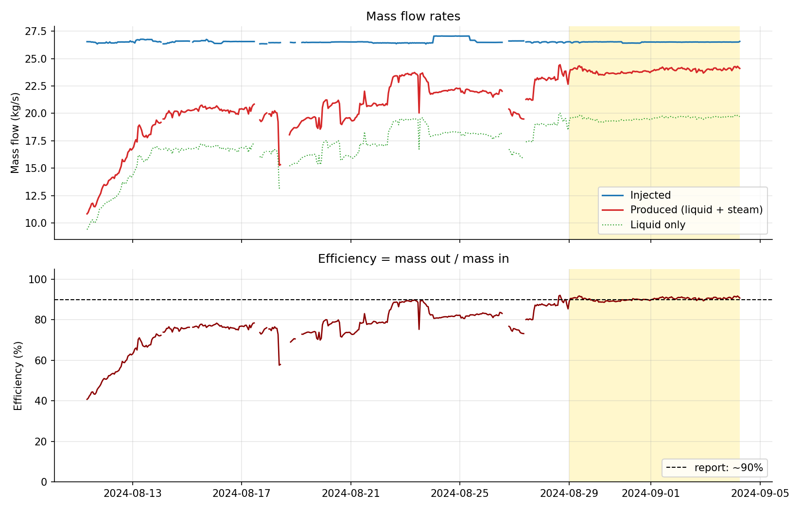
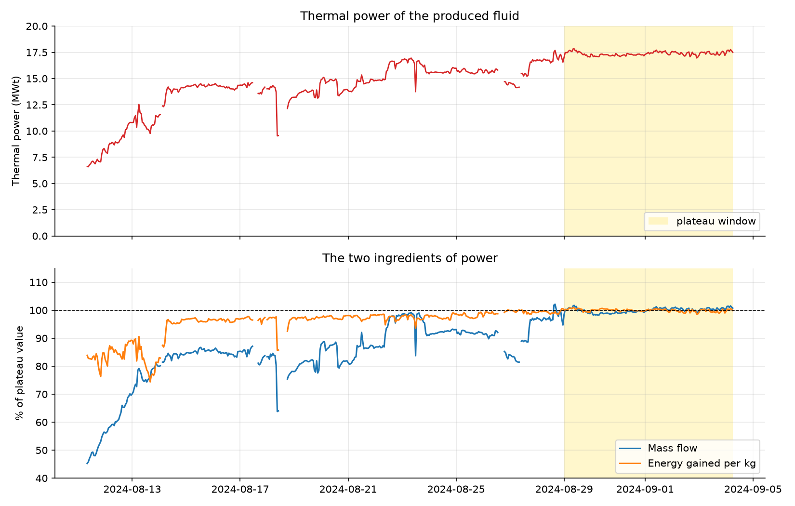
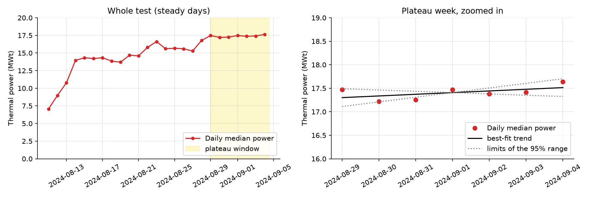

# Geothermal Well Performance Analysis

Performance analysis of the Utah FORGE extended circulation test between wells 16A(78)-32 (injector) and 16B(78)-32 (producer), 8 August to 5 September 2024. The project cleans and calibrates the raw field data, then quantifies injection pressure, fluid recovery, steam fraction, mass-flow efficiency and thermal power.

## Key results

Values are for the plateau (29 Aug to 4 Sep 2024), the last seven days, when the efficiency had stopped changing.

| Metric | Result |
|---|---|
| Mass-flow efficiency (mass out / mass in) | 90.3% (88 to 92% across the assumptions tested). The test report gives about 90% |
| Injected / produced mass flow | 26.5 / 23.9 kg/s |
| Steam fraction at the separator | 18.3% (calculated). The report uses 19.6% |
| Liquid volume recovery | 77% |
| Injection pressure | 2,825 psi, falling about 11 psi/day after 21 Aug (about 5% over two weeks) |
| Wellhead injectivity | 14.9 gpm per 100 psi |
| Producer temperature (corrected) | 375 °F |
| Thermal power | 17.3 MWt (16.3 to 18.4 MWt across the assumptions tested) |
| Heat produced (steady periods only) | 8,187 MWh thermal, a lower bound |
| Power trend over the plateau week | No decline detected. A decline faster than about 1% per week is ruled out |

What the data show:

- Efficiency rose from about 45% on 11 Aug to 90% by 29 Aug. The rise was not monotonic: it reached about 89% on 23 Aug, fell to about 82% after the pump-rate changes of 24 and 26 Aug, and recovered.
- Thermal power rose from about 7 MWt on the first day to about 17 MWt. Of the growth after the producer temperature passed 360 °F, about 80% comes from more water returning and about 20% from hotter water.
- A 6 to 8% dip in power on 24 to 27 Aug coincides with the pump-rate changes. The temperature did not fall, so the dip reflects reduced return flow, not cooling of the rock.
- The seven-day plateau is too short to say anything about decline over months or years.







## Data

- Source: Utah FORGE, *Wells 16A(78)-32 and 16B(78)-32 Extended Circulation Test Data, August and September 2024*, Geothermal Data Repository, submission 1683: https://gdr.openei.org/submissions/1683
- DOI: https://doi.org/10.15121/2475065
- Licence: Creative Commons Attribution 4.0 (CC BY 4.0). The raw files are redistributed in `data/raw/` with attribution.
- Citation: McLennan, J., England, K., & Swearingen, L. (2024). *Utah FORGE: Wells 16A(78)-32 and 16B(78)-32 Extended Circulation Test Data, August and September 2024.* Geothermal Data Repository.

The dataset contains the raw 30-second time series (81,239 rows, 11 columns, Mountain Time), a field calibration of the flow meters, manual temperature and pressure readings, the final test report and a Read Me. The time series is uncorrected: the report describes how the field calibrations are to be applied.

## Method

| Notebook | Module | What it does |
|---|---|---|
| `01_explore` | `load.py` | Loads the files, checks sampling and gaps, plots every raw signal, and identifies sensor biases |
| `02_clean` | `clean.py` | Labels test phases, removes spikes, calibrates the flow meters, corrects the temperature, fills short gaps, flags valid steady periods, writes `data/processed/` |
| `03_performance` | `analysis.py`, `plots.py` | Injection pressure and injectivity, volume recovery, steam fraction, mass flow and efficiency, sensitivity analysis |
| `04_power_decline` | `analysis.py`, `plots.py` | Thermal power, attribution of its growth, decline test on the plateau, heat produced, sensitivity analysis |

Main steps and choices:

- **Phases.** Start times of the ramp-up steps come from the report. The end of the steady 10 bpm phase (11 Aug to 4 Sep) is detected from the injection rate.
- **Spikes.** A Hampel filter (7-reading rolling median) removes isolated spikes. About 90 points are removed in total, out of about 80,000 per column. Real extreme values are kept: the 1,400 to 1,600 psi shut-in pressure on well 16B after the test ended is not treated as an error.
- **Flow calibration.** Each separator flow meter is corrected with a straight line fitted to the field calibration against the pump-truck rate: `true = 0.907 * reading - 9.31` (meter 1) and `true = 0.898 * reading - 5.90` (meter 2), R² above 0.998. The meters read about 10% high.
- **Temperature.** The thermocouple reads low (the report says it did not reach the flowing fluid). A constant +11.3 °F offset (standard deviation 4.6 °F, 72 paired temperature-gun readings) is added while the fluid is hot (above 200 °F).
- **Gaps.** Gaps of up to 5 minutes are filled by linear interpolation; longer gaps stay empty.
- **Valid steady periods.** A flag marks the steady phase when the pump has run at full rate for the previous 2 hours, which excludes pump stops and the settling time after restarts.
- **Plateau.** Working back from the end of the test, days are included while the daily efficiency stays within 2% of its final value.
- **Steam fraction.** Calculated from an energy balance between the well temperature and the separator boiling point (202.1 °F at 5,415 ft), using IAPWS-97 steam tables. The report's 19.6% is used only as a sensitivity case.
- **Efficiency.** Produced mass (separator liquid plus steam) divided by injected mass, as defined in the report.
- **Thermal power.** Produced mass flow times the enthalpy gained relative to the injected water, cross-checked against the textbook mass x specific heat x temperature-rise formula (agreement within about 1%).
- **Sensitivity analysis.** Each assumption is varied in turn: injection water temperature, calibration form, temperature offset, steam definition.

## Limitations

- **Injection water temperature is assumed.** The dataset does not contain it, so 20 °C (ambient pit water, per the report) is used. It changes efficiency by only about 0.2 points per 10 °C but changes thermal power by about 6% per 10 °C. A measured value would be the most useful refinement.
- **Calibration form.** The report shows its calibration equations only in a figure. A line with an intercept is fitted to the eight calibration points here. Forcing the line through the origin raises efficiency by 1.9 points and power by 2.1%.
- **Steam fraction.** The calculated value (18.3%) is below the report's 19.6%, and the report's wording admits two readings. The two definitions tested change efficiency by about -2.0 and +1.5 points.
- **Temperature correction.** A constant offset is used, although the true offset may vary with temperature. Using the raw temperature would lower power by about 5%.
- **Instruments not used.** The producer flow meters upstream of the separator (described as suspect in the report) and the 16B wellhead pressure (described as erratic) are not used for the results. The pressure is kept as recorded and treated as indicative only.
- **Short plateau.** Seven days can rule out fast decline but cannot show long-term decline. Rock cooling develops over months or years.
- **Injectivity.** It is based on wellhead pressure, so only its trend is meaningful. The step on 24 to 26 Aug follows a pump-rate change.
- **Thermal power has no published reference.** The report gives no power figure. Pressure effects on enthalpy (about 2%) are ignored. The values are thermal, not electrical.
- **Heat produced is a lower bound,** because pump stops, settling periods, start-up and wind-down are excluded.
- **One-at-a-time sensitivity analysis.** Combined effects of several assumptions, and noise in the individual measurements, are not propagated.
- **Single test.** The results describe this test only.

## Reproducing the analysis

Requires Python 3.12 or later. Developed on Python 3.14 and checked in a clean environment on Python 3.12.

```
git clone https://github.com/shittuisrael004/Geothermal-Well-Performance-Analysis-Project.git
cd Geothermal-Well-Performance-Analysis-Project
python -m venv .venv
source .venv/bin/activate        # Windows: .venv\Scripts\activate
python -m pip install -r requirements.txt
```

Run the notebooks in order, from `01_explore` to `04_power_decline`. Each reads files written by the earlier ones. `02_clean` writes `data/processed/forge_clean_30s.csv`, which is not committed (11.6 MB) and is needed by notebooks 03 and 04. The notebooks are saved with their outputs, so they can also be read on GitHub without running them.

The raw data is included in `data/raw/`. To download it again, use the link under Data and unzip it into `data/raw/`.

Unit tests for the functions in `src/`:

```
python -m pip install -r requirements-dev.txt
python -m pytest
```

## Repository structure

```
Geothermal-Well-Performance-Analysis-Project/
├── data/raw/          original downloads, untouched
├── data/processed/    cleaned data, correction constants and result tables
├── notebooks/         01_explore, 02_clean, 03_performance, 04_power_decline
├── src/               load.py, clean.py, analysis.py, plots.py
├── tests/             unit tests for src/
├── figures/           figures saved by the notebooks
├── PROJECT_NOTES.md   plan, decisions and assumptions, results log
├── requirements.txt
└── requirements-dev.txt
```

## Licence

The code is released under the MIT licence (see `LICENSE`). The data is licensed separately under CC BY 4.0 by its authors; see Data above.
